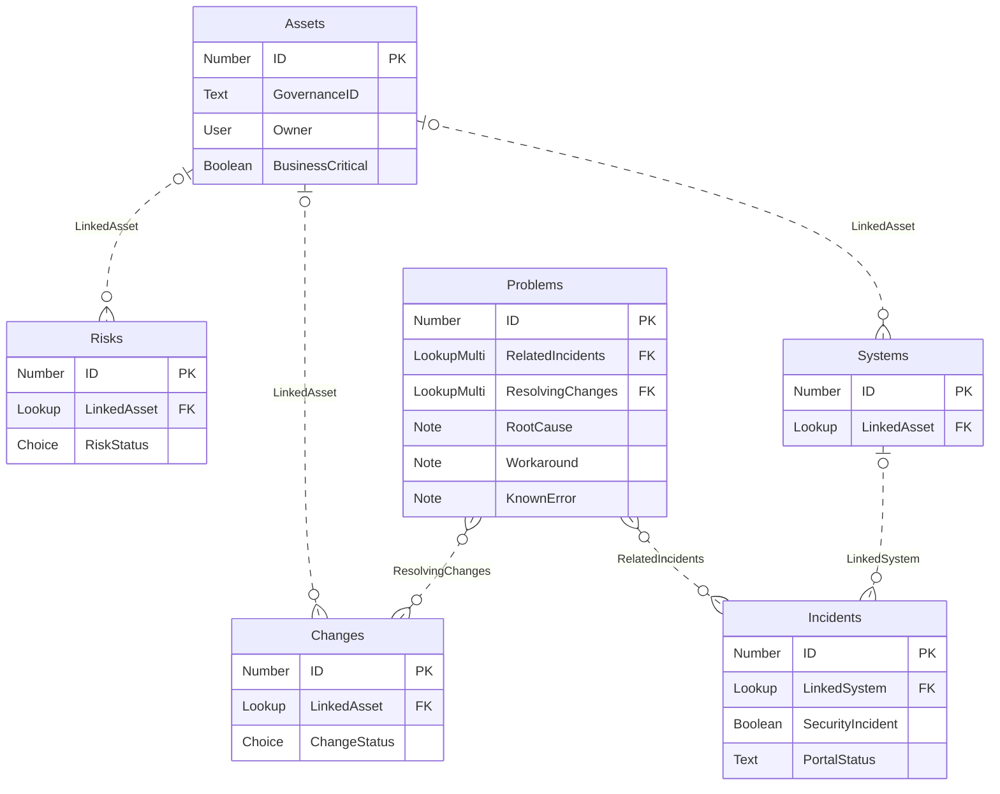
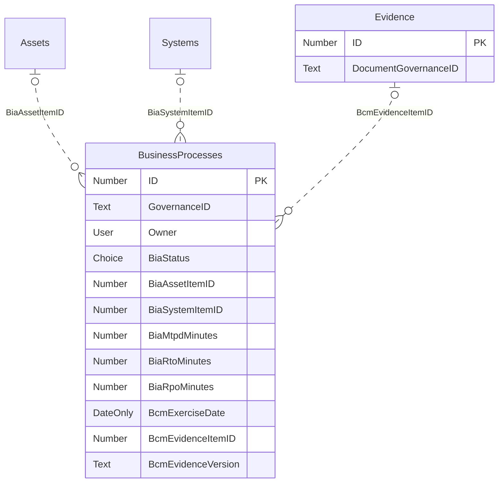
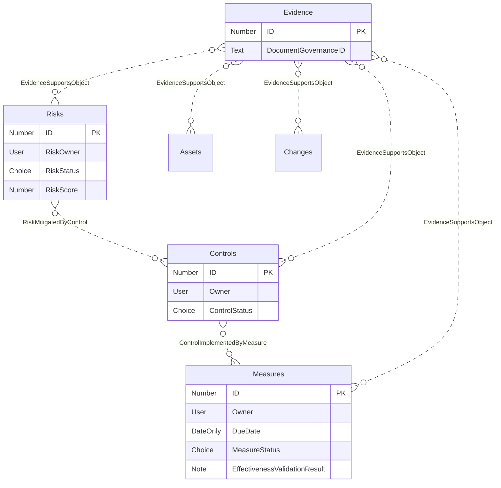
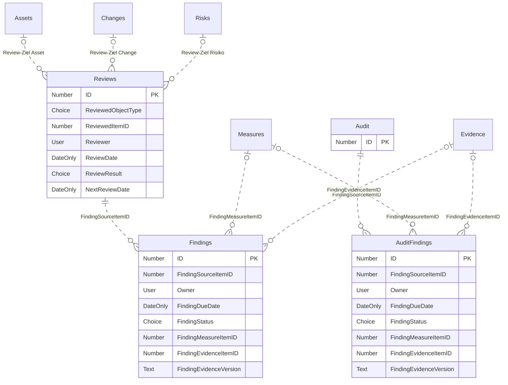

# ER-Diagramm des Governance Portals

Stand 26. November 2026 · **P14 / Canvas 1.0.0-beta.7 / Solution 1.0.0.30526**. Das Diagramm zeigt die fachlichen Listen und Bibliotheken der veröffentlichten App sowie deren Beziehungen. Die Kästen verwenden die internen SharePoint-Namen und zeigen ausgewählte Felder. [Lieferstand](GOV-PORTAL-LIEFERPLAN.md)

`ID` ist der native Schlüssel innerhalb einer Liste oder Bibliothek. Für eine Quellangabe über mehrere Listen hinweg braucht die App den Objekttyp oder den Bibliothekskontext zusätzlich zur ID. `GovernanceID` und `DocumentGovernanceID` sind separate fachliche Kennungen. `Lookup` und `LookupMulti` bezeichnen native SharePoint-Lookups. `DateOnly` steht für ein Datumsfeld ohne Uhrzeit. Numerische Referenzfelder enthalten die Element-ID der jeweiligen Quellliste. Die Kardinalitäten zeigen den fachlichen Bezug. [Objekttypen](../architecture/platform.yaml) · [Felder](../architecture/fields.yaml) · [Objektspezifische Felder](../architecture/object-fields.yaml) · [Mermaid-Notation](https://mermaid.js.org/syntax/entityRelationshipDiagram.html#relationship-syntax)

## Assets und Betrieb

Problems speichert seine n:m-Bezüge zu Incidents und Changes als native Mehrfach-Lookups am Problem. Betriebsstörungen und Sicherheitsvorfälle stehen gemeinsam in `Incidents`. Das Feld `SecurityIncident` kennzeichnet Sicherheitsvorfälle. [P9 im Lieferplan](GOV-PORTAL-LIEFERPLAN.md#p9--betriebsfreigabe-als-beta) · [P12 im Lieferplan](GOV-PORTAL-LIEFERPLAN.md#p12--problems-mit-incident--und-change-bezug)

## Kritische Geschäftsprozesse und BCM

Ein BIA-Entwurf kann die Referenzen offenlassen. Die Bestätigung verlangt ein geschäftskritisches Asset, ein aktives System und gültige Zeitziele. Der Eintrag speichert die letzte dokumentierte Übung am Prozess mit der damals geprüften Evidence-Version. [P14 im Lieferplan](GOV-PORTAL-LIEFERPLAN.md#p14--kritische-geschäftsprozesse-und-bcm) · [BCM-Flow](../powerplatform/flows/build_business_continuity_write.py)

## Risiken, Kontrollen, Maßnahmen und Nachweise

Jede hier gezeigte Zuordnung ist eine Zeile in `GovernanceRelations`. Der eindeutige `RelationKey` schützt wiederholte Zuordnungen. `RelationTypeKey` benennt den Typ aus `RelationTypes`. `SourceObjectTypeKey` und `SourceItemID` identifizieren die Quelle. `TargetObjectTypeKey` und `TargetItemID` identifizieren das Ziel. Ein Nachweis ist bei `EvidenceSupportsObject` immer die Quelle. Die direkten Evidence-IDs von Findings und BCM sind in den jeweiligen Datensätzen gespeichert und führen dort zusätzlich die geprüfte Dateiversion. [Beziehungstypen](../architecture/relations.yaml) · [Nachweis-Flow](../powerplatform/flows/build_evidence_upload.py) · [Kontroll-Flow](../powerplatform/flows/build_control_write.py) · [Maßnahmen-Flow](../powerplatform/flows/build_measure_write.py)

## Reviews, Audit und Findings

- Ein manueller Review bezieht sich je Eintrag auf genau ein Asset, einen Change oder ein Risiko. `ReviewedObjectType` legt fest, zu welcher Liste `ReviewedItemID` gehört. Dieselbe Quelle kann eine Reviewhistorie aus mehreren Einträgen haben. [Review-Flow](../powerplatform/flows/build_review_completion.py)
- `Findings` bezieht sich auf abgeschlossene Reviews. `AuditFindings` bezieht sich auf Dateien der vorhandenen `Audit`-Bibliothek. Beim Abschluss sind eine wirksame oder geschlossene Maßnahme und ein versionierter Nachweis erforderlich. Die Listen und die Audit-Bibliothek behalten ihre jeweiligen Zugriffsgrenzen. [P13 im Lieferplan](GOV-PORTAL-LIEFERPLAN.md#p13--findings-und-abweichungen) · [Finding-Flow](../powerplatform/flows/build_finding_write.py)

## Dokumentbibliotheken und Metadaten

| Quelle | Identität und Fachbezug |
| --- | --- |
| `Policies`, `Procedures`, `Runbooks` | Drei eigenständige Bibliotheken. Jede Datei hat eine eigene Listen-ID und gemeinsame Dokumentfelder wie `DocumentOwner`, `DocumentStatus` und `DocumentReviewDate`. Die fachliche Freigabe speichert unter anderem `ApprovedBy`, `ApprovedDate` und die geprüfte Version in `DocumentVersion`. |
| `Evidence` | Eigenständige Nachweisbibliothek. Zuordnungen werden über `GovernanceRelations` oder über die oben gezeigten direkten Referenzen hergestellt. |
| `Audit` | Vorhandene Bibliothek für Auditdateien und Quelle für `AuditFindings`. |

Die Runtime koppelt Entitäten und Felder über `ObjectTypeKey` in `ObjectTypes`, `FieldDefinitions` und `FormDefinitions`. Formularfelder referenzieren das Formular über `FormDefinitionKey` und das Datenfeld über `ObjectTypeKey` und `FieldInternalName`. Die Auswahllisten verwenden `ChoiceSetKey`. Die Architektur-Baseline enthält weitere Objekttypen wie `Contacts`, `Knowledge` und `Architecture`. Deren Fachintegration liegt außerhalb der hier abgebildeten Beta 7. [P8b im Lieferplan](GOV-PORTAL-LIEFERPLAN.md#p8b--dokumentenpflege-und-fachliche-freigabe) · [Metadaten-Compiler](../provisioning/Modules/Compiler.psm1)

Bei Änderungen an Listen, Lookup-Zielen oder Flow-Referenzen das Diagramm zusammen mit dem führenden Modell und dem Lieferplan aktualisieren.
